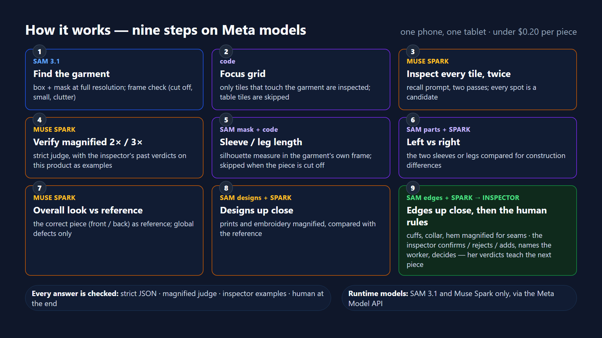

# SOLANG Vision QC

**A camera over the final-inspection table of a children's clothing factory, powered by SAM 3.1 and Muse Spark.**

SOLANG is a real garment factory. At the end of every sewing line a human inspector turns each piece over on a table
and looks for holes, snags, stains, loose threads, bad seams and one leg or sleeve that came out shorter than the other.
Late in a shift, small defects slip through, and the ones that are caught are rarely traced back to the worker or
operation that caused them. Vision QC is a phone or tablet mounted above that table: when a garment is lying still and
the hands leave the frame, it takes a full-resolution photo, runs an inspection pipeline on Meta's models and draws
circles on the spots it suspects. The inspector confirms, rejects or adds spots and makes the final call. It does not
replace the inspector; it is a second pair of eyes that never gets tired, and every verdict it receives is stored so
the system can learn from the people who actually know the garments.

> Built during the Meta Global AI Developer Hackathon (Oct 26 – Nov 4, 2026). The factory's existing production
> system is **not** part of this repo; the demo writes to a throwaway database with fake orders.

## How it works



One photo (typically 3024×4032 from the phone's browser camera, 4284×5712 from its camera app) goes through nine steps. Everything runs in the browser; the
only server is a thin proxy that holds the API key. The method is documented in [`shared/pipeline.js`](shared/pipeline.js).

1. **Find the garment — SAM 3.1.** A downscaled copy is sent with a concept prompt (`pants`, `sweatshirt`, …).
   The largest box becomes the working region and the one-bit **mask** becomes a coarse garment grid (32 px cells, 2 %
   margin, [`shared/focus.js`](shared/focus.js)): it decides which tiles are worth sending, paints the table inside each
   tile flat gray, drops candidates that land off the garment and raises the framing warnings (garment cut by the frame
   edge, too small, something else on the table). No box at all → the run stops with «no garment» instead of inspecting
   the floor.
2. **Tiles at full resolution — Muse Spark.** The garment region is cut into overlapping 1200 px tiles
   (200 px overlap); tiles with less than 8 % garment in them are not sent. Each tile is inspected for *local* defects,
   in parallel (10 at a time), and answers in a 0–1000 grid that is mapped back to photo pixels. The tile prompt is
   deliberately **high-recall** (point at anything that could be a defect, low confidence allowed): on two 12 MP
   captures the earlier strict prompt returned zero candidates while the recall prompt surfaced the confirmed stain;
   the verify step below is the strict filter.
3. **Merge.** The same spot seen in two overlapping tiles becomes one candidate (and counts as two hits).
4. **Verify crops — Muse Spark.** Every candidate is re-checked on a 2× magnified 500 px crop with a tri-state
   answer: *defect / lint / texture / unsure*. If the first look is not "defect", a second opinion is asked on a 3×
   crop. Lint and texture are dropped unless two tiles agreed strongly, in which case they stay as amber "unsure".
   When the inspector has already judged crops of this product, up to 3 *defect* and 3 *not a defect* examples from
   `vision_examples` ride along on both looks as labelled references — the learning loop.
5. **Silhouette from the SAM mask — no model call.** Leg or sleeve length is measured from the waistband/collar
   centre on the mask, in the garment's own frame (a piece laid sideways is measured on the transposed mask); a
   difference above 5 % (legs) or 3.5 % (sleeves) becomes an amber length finding, 8 % / 10 % red. No measurement
   when the garment touches a frame edge (the cut side reads as the shorter one). See the results section for how
   reliable this is: the direction is usually right, the number is only close when the sleeves lie parallel.
6. **Mirror comparison — SAM 3.1 + Muse Spark.** SAM finds the two legs (or sleeves); the right one is flipped
   horizontally and compared with the left one. Spark is asked twice at `medium` effort, and both answers must say
   "different" before an asymmetry finding is raised (one answer alone is fooled by how the fabric is laid).
7. **Global pass — Muse Spark.** The whole garment, downscaled, optionally next to a known-good reference: misplaced
   or incomplete print, missing part, twisted seam.
0. **A reference per product and side (optional).** A photo of a correct piece, flat and from above — front and/or back —
   taken at the station («📌 use this piece as the front/back reference», decision bar; or shot by the phone on the tablet's
   command) or anywhere else and uploaded («⋯ → 📌 reference from a photo»). Stored as `demo_orders.reference_url` /
   `reference_back_url` for every order of that model; shown as 📌 next to the order. Both sides ride along in step 7 (the
   prompt says which is which, so the back of a hoodie is no longer «a different print» next to a front reference) and
   step 8 (how the designs are supposed to look).
8. **Embroidery and print close-ups — SAM 3.1 + Muse Spark.** SAM is asked for the *embroidered* and *printed* designs on
   the garment; each one (up to 4, largest first) is cut from the full-resolution photo, magnified up to 3× and inspected
   on its own for loose embroidery thread ends, skipped or broken stitches, cracked or missing print. A thread end on an
   embroidered eye is 2 px in the corner of a tile; here the design fills the model's view. Findings the tiles already
   confirmed within 150 px are not reported twice.
9. **Cuffs, collar and hems close-ups — SAM 3.1 + Muse Spark.** SAM is asked for the sleeve cuffs, the collar and the
   bottom hem (waistband and leg hems on pants); each is cut from the full-resolution photo, magnified up to 3× and
   Spark is asked only about the seam: open or unstitched sections, skipped stitches, a raw edge, a band not fully
   attached, a hole at the seam. Added on Oct 31 after an open cuff seam on a pink sweatshirt — about 15 px at 12 MP —
   went past the tiles; magnified three times, the same spot reads at 85 %. Strict threshold (≥ 0.6), merged with the
   tile findings like step 8; zero false alarms on the three other photos of that day.

```
 phone/tablet above the QC table
   │ garment still + hands out of frame → full-resolution photo
   ▼
 ┌─ SAM 3.1 ──────────────┐  concept "pants"/"sweatshirt"
 │ garment box + 1-bit mask│──────────────────────────────┐
 └───────────┬─────────────┘                              │ mask
             │ crop to garment                            ▼
             ▼                                 ┌─ silhouette (no model) ─┐
 ┌─ Muse Spark · tiles ───┐  N overlapping     │ leg/sleeve length diff  │
 │ local defect candidates│  1200 px tiles     └────────────┬────────────┘
 └───────────┬─────────────┘                                │
             │ merge duplicates across tiles                │
             ▼                                              │
 ┌─ Muse Spark · verify ──┐  2× crop (+3× second opinion)   │
 │ defect/lint/texture/?  │                                 │
 └───────────┬─────────────┘                                │
             ▼                                              │
 ┌─ SAM parts + Spark mirror ─┐  left vs flipped right,     │
 │ construction asymmetry     │  asked twice                │
 └───────────┬─────────────────┘                            │
             ▼                                              │
 ┌─ Muse Spark · global ──┐  whole garment (+ reference)    │
 │ print / missing part   │                                 │
 └───────────┬─────────────┘                                │
             ▼◄─────────────────────────────────────────────┘
 circles on the photo → inspector confirms / rejects / adds → decision
   → Supabase: inspection · findings · confirmed crops as examples
```

Red circle = confidence ≥ 0.8, amber = 0.5–0.8; findings from the silhouette, mirror and global steps are drawn
dashed (blue in the harness's annotated JPEGs).

## Meta tooling used

**The only models called at runtime are Meta's: SAM 3.1 and Muse Spark 1.3, through the Meta Model API.** No other
model, hosted or local, runs anywhere in the pipeline or the station; the rest is plain JavaScript (geometry on SAM's
mask, pixel comparisons for the empty table and the stillness detector).

- **SAM 3.1** through the Responses API with a text concept prompt and
  `metadata: { include_confidence: 'true', mask_encoding: 'one_bit' }`. Used five ways: garment box, garment mask,
  part boxes (`pant leg` / `sleeve`), the embroidered and printed designs (step 8), and the cuffs, collar and hems
  (step 9) — every close-up starts from a SAM box, never from a guess.
- **`@meta-sam/parser` 0.1.0** (vendored, unmodified) parses the SAM output stream and decodes the one-bit mask to a
  raster (`parseImageStream`, `recordsOfKind`, `decodeMaskToRaster`). The raster is what the silhouette measurement
  runs on.
- **Muse Spark 1.3** vision reasoning through the Responses API (`input_image` data URLs), with reasoning effort
  chosen per step: `low` for tiles, verify and global, `medium` for the mirror comparison. `minimal` on tiles was
  faster but missed a known hole in one run out of three, so it is not used; higher efforts were not worth their
  seconds on a one-minute-per-piece budget — the effort sweep in the hackathon's Fireworks workshop (Oct 30) showed
  the same thing on text benchmarks: more reasoning is not automatically more accuracy.
- **Cloudflare Worker proxy** ([`worker/src/index.js`](worker/src/index.js)): the browser never sees the Meta key.
  The worker checks a station token, allow-lists paths and models, forces `stream:false`, caps the body size and
  applies a per-IP daily limit.

## Human in the loop, and the learning loop

The page suggests; the inspector decides. Each circle has «✓ عيب» / «✗ مش عيب» buttons, the inspector can tap any
spot the camera missed («➕ عيب ما لقطتو»), attribute a confirmed defect to a worker on the order's line, and pick
the decision: pass / repair / reject. Nothing is auto-rejected.

Every verdict is stored twice: as a row in `vision_findings` (the spot, the model's confidence and reasoning, the
inspector's verdict and who caused it) and, for confirmed, added or rejected spots, as a 2× crop in `vision_examples`
labelled `defect` or `not_defect` per model code. They are read back on the next inspection of the same product: up to
3 *defect* and 3 *not a defect* crops ride along in the verify step (step 4) as labelled references, so the magnified
judge decides with the inspector's own history in front of it (the station shows «🧠 N examples» under the result).
On the factory table this is what turned a missed seam thread into a catch: inspection #40 missed it and the inspector
marked it; #41, on the same product with her two examples, found it at 85 %.

## Results — 38 inspections on the factory table (Oct 29 – Nov 1, 2026)

Every number below comes from the demo database as it stands — `node dev/accuracy.mjs`, saved in
[`docs/accuracy-2026-11-02.md`](docs/accuracy-2026-11-02.md) — and from the inspector's verdicts on each spot. The inspector
was the co-founder himself. 38 inspections of about 15 physical pieces (the same piece was often inspected again after a
change: a different lay, a new defect seeded on it, a re-take for the video); 10 of them are pieces believed clean. Most
defects were real production defects; a few were **seeded on purpose** to test a specific check and are marked so below.

| | |
|---|---|
| Inspections | **38** (front 32, back 6) — pass 10, repair 24, reject 4 |
| Candidates raised by the tiles | 175 → the magnified check confirmed 49, flagged 6 unsure, dropped 120 (69 %) |
| Spots shown to the inspector | **70** — confirmed **38**, rejected **32** → **precision 54 %** |
| Spots the inspector added herself (camera misses) | **10** → **recall 79 %** on the spots she judged or added |
| By level | red 44 spots, 71 % confirmed · amber 36 spots, 39 % confirmed |
| By type | loose thread 21/25 confirmed (84 %) · hole 4/7 · sleeve length 5/8 · **stain 7/22 (32 %)** · mirror asymmetry 0/3 |
| Time per piece | mean **70 s** on the factory Wi-Fi (min 29, max 207) — 25–45 s on a good link; the slow runs are uploads, not models |
| Cost per piece | ≈ **$0.16** in Muse Spark tokens + ≈ $0.02 in SAM calls, about **$0.18**; the demo so far cost $5.90 |

**What it caught (real production defects unless marked):** loose threads at seams, cuffs and hems (its strongest
type); a 1.5 cm hole; a thread across a print (design close-up); a brown stain on a printed panel (seeded, design
close-up, 85 %); an open cuff seam ≈ 15 px wide on a sweatshirt — invisible to the tiles, read at 85 % once step 9
magnified the cuff; a seam thread on an olive hoodie on the third try, with the inspector's examples (the learning
loop above); sleeve-length differences — see the next paragraph.

**What it missed, honestly:** a red pen mark on orange fleece and an oil stain on light gray (contrast, under factory
light); a white thread hanging over a white board (zero contrast — a background problem); an open seam at the hood,
which step 9 does not cover (cuffs, collar, hem only — a 3× crop of that spot reads it at 75 %, so the extension is on
the roadmap); and small stains in general: the stain type is the weak spot at 32 % precision, most of its false alarms
being lint or a dark speck on light fabric.

**The sleeve-length check, with the tape next to it.** Orange hoodie, real difference 1.5 cm = 5.1 % of the sleeve:
flagged once (4.4 %, when the sleeves lay parallel), missed on six other lays (1.3–2.6 %). Gray hoodie, real difference
1.5 cm = 3.2 %: flagged at 8.5 % — right direction, inflated 2.6× because one sleeve lay diagonally. Olive hoodie,
1 cm: flagged at 7.9 % with the hood spread next to a sleeve. Pink hoodie with **equal** sleeves: 7.4 % false alarm on
a diagonal lay, 0.8 % and no alarm once the sleeves were laid parallel and the hood folded. Test piece (pink blouse)
with a seeded 4 cm difference: flagged at 3.6 %, tape 39 vs 43 cm. Reading: the check flags real differences but the
percentage is a lay-dependent estimate, so the station says «rough estimate — check with a tape», the lay rule
(sleeves parallel, hood folded, nothing cut off) is in the operator guide, and a measurement along the sleeve itself is
on the roadmap. The tape stays the judge for differences under 2 cm.

**Calibrated from the inspector's verdicts (Nov 2).** Tile findings the magnified check confirmed at 60–69 % confidence
were real 2 times out of 10 (70–79 %: 7 of 13; 80 %+: 21 of 30), and every false alarm on that day's clean pieces sat in
that band — so a confirmation below 0.70 is now dropped (`TILE_CONFIRM_MIN` in [`shared/pipeline.js`](shared/pipeline.js)).
The table above is the raw record *before* that change; re-run offline on the same photos, the clean white piece went
from one 65 % «stain» to zero findings and the defective olive hoodie kept its seam thread.

**Caveats.** One inspector, who also built the system; repeated inspections of the same pieces; several seeded defects;
verdicts on «stain»-type spots are the least certain (a speck of lint and a faint stain look alike at 2×). Returns: the
factory's own estimate is that roughly 15 % of orders come back with a defect involved; there is no audited figure (the
shop platform does not report returns), so the video states a goal — under 5 % — not a current rate.

## Earlier: preliminary results — 7 photos (Oct 26–27)

This is a **preliminary evaluation on 7 photos** of real garments from the factory, each with a defect the inspectors
already knew about, run once each through [`dev/run_pipeline.mjs`](dev/run_pipeline.mjs) on Oct 26, 2026. It is not a
benchmark; the numbers below are copied from the per-photo result JSON of that run. Cost uses the price assumptions
written in [`station/CONTRACTS.md`](station/CONTRACTS.md) ($1.25 / M input tokens, $4.25 / M output tokens, $0.0025 per
SAM call) and should be checked against current Meta pricing.

| Photo | Garment · known defect | Found? | Level · confidence | Time | Cost |
|---|---|---|---|---|---|
| IMG_1284 | pink pants · one leg shorter | **yes** (silhouette, 6.2 % length difference) | amber 69 % | 26.7 s | $0.066 |
| IMG_1285 | green sweatshirt · double seam | **no** — 0 findings | — | 39.6 s | $0.091 |
| IMG_1286 | orange sweatshirt · loose collar threads + a hole | threads **yes**; a second spot just above the cuff seam, typed `hole` in this run (`stain`, red 85 %, in an earlier run of the same photo — same spot, not yet checked on the garment) | red 90 % · amber 75 % | 22.3 s | $0.086 |
| IMG_1288 | grey ribbed pants · tiny hole | **no** — 0 candidates | — | 34.5 s | $0.072 |
| IMG_1289 | pink pants · believed clean, has a small snag | **yes** | amber 65 % | 21.4 s | $0.047 |
| IMG_1290 | black pants · seam asymmetry | **yes** (mirror, 2 of 2 votes) | red 85 % | 20.1 s | $0.099 |
| IMG_1292 | cream sweatshirt · frayed bow + faint stain | bow **yes** (global pass, `print`); stain **no** | red 85 % | 25.7 s | $0.056 |

Honest reading of that table:

- **Misses:** the tiny hole on the grey pants (no tile produced a candidate), the double seam on the green sweatshirt
  (one mirror vote said "different", the second did not, so no finding) and the faint stain on the cream sweatshirt.
  Of the 9 known defects, 5 were clearly flagged, 1 is unresolved (a spot above the cuff seam of the orange
  sweatshirt, typed `hole` in one run and `stain` in another; not yet checked against the piece), 3 were missed.
- **Extra flags:** 3 amber "hole" flags on IMG_1284 (70–75 %) that are not in the known-defect list, and 2 amber
  "unsure" flags on IMG_1290 where the verifier said *lint* but two tiles had agreed. All extra flags are amber, none
  red; they cost the inspector one tap each. In the same run the verifier dropped 2 other candidates as lint or
  texture (1 on IMG_1284, 1 on IMG_1285), so they never reached the inspector.
- **Garment detection** worked on all 7 (SAM box confidence 0.55–0.97, mask available every time).
- **Across the 7 photos:** 74 tiles, 109 Spark calls, 14 SAM calls, 215,723 input and 49,980 output tokens,
  190 s total (average 27 s per garment, range 20.1–39.6 s), about $0.52 in total (average $0.07 per garment).
  Five photos were run with the first, sequential version of the pipeline (21–40 s); IMG_1286 and IMG_1290 were
  re-run after the tile/verify branch and the mirror/global branch were made concurrent (38.8 s → 20.1 s on the
  black pants, 29.2 s → 22.3 s on the orange sweatshirt, same findings at the same spots). In the browser station
  the same photos take 20–30 s end to end.

The raw result JSONs and the annotated JPEGs of that run are committed in [`dev/out/annotated/`](dev/out/annotated/)
(the original photos are git-ignored); the fields used above are `findings[]`, `candidates`, `verified[]`,
`parts.mirror.votes`, `garmentBox.c`, `usage` and `timings.total`.

**Timing (Oct 27):** the parts/mirror comparison and the whole-garment pass now run side by side, and the parts SAM call is sent
while the garment is still being located; the station sends up to 10 tile calls at once (was 6). IMG_1286: 22.3 → 21.6 s on the
same findings — the remaining critical path is the two mirror calls (~17 s). A 12 MP phone photo that took 39 s on the old
ordering should land around 25 s (estimate, not yet measured on the phone). Measured on the phone that evening: 31.5 s.

**Re-run, Oct 27 (garment focus on, 10 tiles at a time, no learning examples in the harness):** the same 7 photos through
the pipeline as it is now — tiles without garment skipped, table painted out inside each tile, off-garment candidates dropped.

| Photo | Known defect | Oct 26 | Oct 27 | Time |
|---|---|---|---|---|
| IMG_1284 | short leg | silhouette amber 69 % | silhouette amber 69 % · plus a `hole` red 85 % and a `stain` amber 65 % not in the known list (not yet checked on the piece) | 22.9 s |
| IMG_1285 | double seam | missed | missed; 4 of 15 tiles were pure table and were not sent; framing warned «cut: left» (a sleeve touches the frame edge) | 21.6 s |
| IMG_1286 | collar threads + hole | red 90 % · amber 75 % | threads red 85 % · hole red 80 % · plus a `stain` amber 65 % | 19.5 s |
| IMG_1288 | tiny hole | missed | missed (0 candidates) | 20.8 s |
| IMG_1289 | small snag | amber 65 % | 0 in the first run; an A/B right after: **found in 2 of 2 runs with focus** (62 %, 70 %) and in 1 of 2 without (65 %, miss) — tile detection is stochastic at `low` effort | 12.6–18.8 s |
| IMG_1290 | seam asymmetry | mirror red 85 % | mirror red 85 % (2 of 2 votes) · the same 2 amber «unsure» lint flags | 19.5 s |
| IMG_1292 | frayed bow + faint stain | global `print` red 85 % | global `print` red 85 % · plus mirror `asymmetry` red 90 % (the sleeve bows differ left vs right — plausible, to be checked on the piece) | 21.0 s |

Reading: no known defect found on Oct 26 was lost; three new flags appeared that are not in the known list and need a
look at the garments; every photo now runs in 12.6–22.9 s (was 20.1–39.6 s); painting the table out did not hurt
detection (the A/B above) and tiles were skipped only where the box held pure table. Garment found on all 7 (SAM box
0.55–0.97). The Oct 27 result JSONs and annotated JPEGs are in [`dev/out/annotated/oct27/`](dev/out/annotated/oct27/).

## Repo layout

```
shared/pipeline.js            the inspection pipeline (browser and Node share it; adapters are injected)
station/                      the station page (plain ES modules, Arabic RTL with an English switch, no build step)
  index.html · style.css · app.js     UI
  i18n.js · welcome.js                UI language (Arabic is the source text, English on top) · first-visit card
  camera.js · browser-image.js        camera + stillness detector, image adapter
  api.js                              proxy client + Supabase REST client
  config.example.js → config.js       per-deployment values (publishable key + station token only)
  vendor/meta-sam-parser/             @meta-sam/parser 0.1.0, vendored (SAM License, see NOTICE.md)
  CONTRACTS.md                        the module contracts the five parallel builders coded against
worker/src/index.js           Cloudflare Worker proxy; worker/wrangler.toml
sql/demo-schema.sql           demo tables + fake orders/workers; sql/storage-policies.sql  bucket + policies
dev/serve.mjs                 local static server + /v1/* proxy (reads meta_key.txt)
dev/run_pipeline.mjs          Node harness (sharp): runs the pipeline on a photo, writes JSON + annotated JPEG
dev/summarize.mjs             prints a summary of saved results without calling the API
dev/tests/                    plain Node tests (node dev/tests/<name>.mjs)
dev/*_probe.py, dev/*.mjs     early API probes from the first day (exploration, not needed to run)
docs/DEPLOY-ar.md             deployment guide in Arabic for the factory
```

## Run locally

Requirements: Node 22+ and Chrome. No `npm install` is needed for the station itself.

1. Put your Meta API key in `meta_key.txt` at the repo root (git-ignored; the dev server reads it, nothing else does).
   For `wrangler dev` / the Worker, copy [`.dev.vars.example`](.dev.vars.example) to `.dev.vars` and fill `META_API_KEY`.
   Never commit a key; the judges' hosted demo above needs none (the key sits in the Worker).
2. Copy [`station/config.example.js`](station/config.example.js) to `station/config.js`. For local runs leave
   `PROXY_URL` empty (the dev server proxies `/v1/*`), fill in the demo Supabase URL and publishable key.
3. `node dev/serve.mjs` and open <http://localhost:8787/station/>.
4. On a desktop there is no table camera: use the «📁 صورة من الجهاز» file button with any garment photo. The whole
   pipeline runs in the browser exactly as on the tablet. The station is in Arabic for the inspectors; `?lang=en` or the
   «English» button switches the interface, and the model writes its reasons in the language the device ran in (so
   the factory's saved inspections carry Arabic reasons even when browsed in English).
5. Demo database: run [`sql/demo-schema.sql`](sql/demo-schema.sql) then [`sql/storage-policies.sql`](sql/storage-policies.sql)
   in a Supabase project's SQL editor (the hackathon demo project already has them applied).

Pipeline without a browser (the harness used for the table above):

```sh
cd dev/node && npm install          # sharp + @meta-sam/parser, Node only
cd .. && node run_pipeline.mjs photos/IMG_1284.jpg --garment pants     # run from dev/ (it reads ../meta_key.txt)
node summarize.mjs                  # re-print saved results from out/annotated/*.json
```

## Deploy

Full step-by-step guide in Arabic for the factory: [`docs/DEPLOY-ar.md`](docs/DEPLOY-ar.md). Short version:

**One link (how the demo is deployed):** [`_worker.js`](_worker.js) + the root [`wrangler.toml`](wrangler.toml)
make the repo a Cloudflare Worker with static assets: `/v1/responses` is proxied to the Meta API with the key kept as a
Worker secret, everything else is served from the repo files ([`.assetsignore`](.assetsignore) keeps dev scratch out).
In the Cloudflare dashboard: Workers & Pages → Create → Import a repository → pick the repo → Deploy; then Settings →
**Runtime variables and secrets** → add `META_API_KEY` as a Secret (optional `STATION_TOKEN`). Every push to `main`
redeploys. The station is at `https://<project>.<account>.workers.dev/station/` and `station/config.js` keeps
`PROXY_URL: ''` (same origin), exactly as in local development. Live demo:
<https://solang-vision-qc.saadmansour.workers.dev/station/> — Arabic by default (the factory's language); the first
visit shows a card to pick English or Arabic and a 3-step how-to for trying it with one phone, and `?lang=en` opens it
in English directly. **No garment or camera at hand?** The camera panel and «⋯» carry «🧪 Try a sample»: three factory
photos with known defects (the factory's own «fast flips» sweatshirt with a loose thread and a hole, pink pants with a
hole and a stain, and a girls' hoodie straight from the inspection table on Oct 29 — inspection #4, where the inspector
confirmed a thread on the embroidered heart and a stain — SOLANG's own designs, nothing licensed) are bundled under
`station/samples/` and run exactly like a shot. Local check of the same setup: `npx wrangler dev` (or
`npx wrangler pages dev . --port 8788`) with the key in `.dev.vars`.

**Separate worker (alternative):** [`worker/src/index.js`](worker/src/index.js) with
[`worker/wrangler.toml`](worker/wrangler.toml); then set `PROXY_URL` in `station/config.js` to the worker URL.

**Two devices at the table:** the phone mounted above the table opens `/station/?mode=camera` (captures when the
garment is still, inspects, saves the inspection with the decision left open) and the inspector's tablet opens
`/station/?mode=review` (no camera; a new inspection pops up with its circles and crops, the inspector confirms /
rejects / attributes / decides, and the next piece opens automatically). The tablet also shows the phone's state and has a
**📸 shoot** button that tells the phone to capture now, plus a **live view of the phone's camera** so the operator sees the
whole garment is in frame before shooting (WebRTC, peer to peer, same Wi-Fi only — [`station/live.js`](station/live.js)).
The two devices talk over a Supabase Realtime broadcast channel ([`station/link.js`](station/link.js), no table, no SQL)
and hand the inspection itself over through the demo database — a row is released to the tablet only once its photo,
preview, crops and finding rows are all uploaded.
The first open on a device shows a **setup screen**: the role of the device (phone above the table / inspector's
tablet / one device), the pairing code and a name, stored on the device; `?mode=camera|review|all` still overrides it
(⚙️ in the top bar reopens the screen). The camera is started by a clear tap the first time (the browser's permission
prompt follows it) and by itself afterwards. «📶 Connection check» (setup screen and under «⋯») uploads 1 MB to the
proxy's `/ping` and reports Mbit/s: on a factory Wi-Fi this, not the models, is usually why a piece takes long. HTTPS
is required for the camera; add the page to the home screen.

## Verification layers

The model proposes; nothing it says reaches the inspector unchecked, and nothing is decided without a human. In the
vocabulary of Meta's hackathon workshop on verifiable agents (deterministic checks → LLM-as-judge → ground truth from a
domain expert → human in the loop, with the speed/accuracy trade-off made explicit):

| Layer | What it is here | Where |
|---|---|---|
| **Deterministic checks** | Every model answer must parse as the exact JSON shape; defect types are whitelisted; coordinates are clamped to the photo; candidates that land off the garment mask are dropped; a tile with less than 8 % garment is never sent; a failed model call marks the run **incomplete** instead of letting it read as «clean»; no garment box → the run stops. The proxy allow-lists models and reasoning effort and refuses other origins. | `shared/pipeline.js`, `_worker.js` |
| **LLM-as-judge** | Every tile candidate is re-judged on a 2× crop with a tri-state answer (defect / lint / texture / unsure) and, if not confirmed, on a 3× crop; lint and texture are dropped. The mirror comparison needs two independent «different» votes and is amber at most. Each tile and each design is asked twice and the answers merge (a spot seen twice counts twice); the edge close-ups (step 9) use a stricter threshold (≥ 0.6) because a seam verdict comes from one look. | pipeline steps 4, 6, 8, 9 |
| **Ground truth from the domain expert** | The inspector's confirmed and rejected crops of the same product ride along with the judge and with the design close-ups as labelled references; a reference photo of a correct piece per product rides along with the global pass and the close-ups. | `vision_examples`, `demo_orders.reference_url` |
| **Human in the loop** | Every spot is confirmed or rejected by the inspector, who can also add spots the camera missed; the piece's decision (pass / repair / reject) is hers alone; a run that was incomplete says so on her screen. | the review screen |
| **Speed vs accuracy, measured** | The high-recall tile prompt costs +50 % tokens for the same wall-clock; asking twice +40 % and +3 s; the design close-ups +4 s; the edge close-ups +7–9 s in parallel with the other stages (no change in wall-clock on a good connection). All four are on, by the factory's choice, after each surfaced a defect the previous version missed. | README build log, Oct 28–31 |

The station shows this on every piece: «🔎 tiles raised N candidates · the magnified check confirmed K and dropped M ·
design close-ups: D · edges and seams: E» (`result.summary`), so the inspector sees the filter working rather than wondering why 8 became 3.

## Safety and privacy

- The demo database is a **separate, throwaway Supabase project with fake orders and workers**; the factory's
  production system is not connected. All keys (Meta, Supabase, station token) are revoked after judging.
- **No faces are recorded.** The camera points straight down at the table; inspectors' hands may appear at the edge
  of a frame before the stillness detector fires. Photos are of garments.
- The Meta key lives only in the Worker secret (production) or `meta_key.txt` (local); the page gets a station token.
  The proxy allow-lists models and paths, requires the page's own Origin, allows only `low`/`medium` reasoning effort,
  caps the body at 8 MB and applies a **per-IP daily limit** (well-formed requests only, past days evicted) so a public
  demo link cannot drain credits; a spend cap on the Meta account is the real backstop.
- The publishable Supabase key can only insert into the demo bucket (no SELECT, UPDATE or DELETE policy): evidence
  photos cannot be listed, overwritten or erased from the page; each one is reachable only by its own public URL. The demo tables themselves have RLS off (fake data, throwaway project).
- The phone ⇄ tablet link is a **public Realtime channel** of the same throwaway project: anyone holding the demo key
  could ask the phone to shoot. The phone accepts at most one remote shot per 6 s, ignores replayed requests and, once a
  **pairing code** is typed on both devices (tap the status line), ignores every request that is not signed with it. A
  production deployment would use private channels with Realtime authorization.
- The live view uses **no STUN or TURN server** and both sides exchange **only private / link-local / mDNS addresses**
  (public candidates are dropped from offers, answers and trickle messages), so the stream cannot be set up with a peer
  outside the local network even if that peer owns a public address. The video never touches a server.
- The empty-table calibration photo (256 px gray) never leaves the phone: it lives in the browser's local storage.
- The local dev proxy answers only same-origin requests from its own station page (no CORS on `/v1/*`, Host checked),
  so a page from another origin cannot spend the developer's key.
- Model output is free text; the UI builds DOM with `textContent` only, never `innerHTML`.

## Roadmap

- The learning loop is wired (the inspector's confirmed / rejected crops per product ride along in the verify prompt and
  the design close-ups); next: measure its effect on repeated false alarms over a week of real inspections. Once those
  verdicts are in the hundreds, fine-tune **Muse Glimmer** on them (Fireworks offers free Glimmer training through
  November) into a SOLANG-specific defect classifier that pre-screens the tiles before Spark looks.
- **Measurements against the size spec.** The silhouette step already measures from the SAM mask in pixels, but as a
  lay-dependent estimate (see the results section: right direction, inflated or missed when a sleeve lies diagonally or the
  hood is spread). Next, in this order: measure along the sleeve itself (skeleton of the mask region) instead of the outer
  outline; then a scale on the table (a 10 cm
  printed square in a corner, or a one-time calibration with an A4 sheet since the phone is fixed) and a spec table per
  model and size (body length, chest width, sleeve length, tolerance) → a card «body length 42 cm, spec 44 ± 1». The
  inspector picks the size before the shot; the piece must lie flat and neck-up. Realistic accuracy on knits about ±1 cm,
  so it flags «out of tolerance by 2 cm», not half a centimetre.
- Recall on tiny holes and faint stains: the high-recall tile prompt and the second pass are in; what is left is smaller
  tiles on dark plain fabrics and a 24 MP input path (the Camera-app photo picked with 📁 already finds what 12 MP misses).
- Fewer extra amber flags: use the inspector's rejections per fabric to raise the amber threshold where lint is common.
- Speed: the design close-ups are now the long pole (about 40 s of a 60 s piece) — run their SAM call alongside the
  tiles; the other half is the factory Wi-Fi (the same photo: 24 s on a home connection, 66 s on the inspection floor).
- Integration with the factory's production system (order list, worker attribution to the real salary codes) — the
  demo's order list and «➕ new product» stand in for it.

## Build log

Everything in this repo was written after the hackathon opened on Oct 26; the commit history is the detailed record. In short:

- **Oct 26 (day 1):** probes of SAM 3.1 and Muse Spark on factory photos → pipeline (tiles, verify, silhouette, mirror,
  global) → Node harness and the 7-photo run above → browser station (camera, stillness detector, circles, cards, save to
  the demo Supabase) → adversarial review and fixes → one-link deployment (Worker built from GitHub).
- **Oct 27 (night):** first real test with a phone above a table at home → two-device mode (phone = camera, tablet = review)
  → the tablet's shoot button over a Realtime channel → live view of the phone camera (WebRTC, LAN only) → pipeline
  reordering (−8 s) → garment focus, framing warnings, empty-table calibration, learning loop, 7-photo re-run.
- **Oct 27 (day):** first-visit card (language choice, then a 3-step how-to for trying it with one phone) and a full
  English UI (`?lang=en` or the top-bar button; the Arabic strings stay the source text, `dev/tests/test_i18n.mjs`
  keeps code and dictionary in sync).
- **Oct 28:** a test on the factory's own Wi-Fi took 56–81 s per piece (every stage 2–4× slower than at home, so bandwidth,
  not the models) → device setup screen (role, pairing code, name), camera started by a tap, one-row camera controls with
  a frame guide, «📶 connection check» (`/ping`) and a live-view timeline on the tablet, lighter uploads (JPEG 0.85, 2+2
  references at 320 px) and **early release**: each piece reaches the review screen after the preview, crops and rows
  (seconds), the full photo and the annotated copy follow in the background.
- **Oct 28 (evening):** a stain the station missed twice at 12 MP was found from the same garment photographed with the
  phone's camera app (24 MP). Re-running that photo through the harness: 24 MP finds it, a 12 MP downscale does not,
  and smaller tiles (850 px) do not bring it back — capture resolution, not tiling, is the limit (the iPhone browser
  stream tops out at 12 MP video frames; the camera app shoots 24 MP photo mode). An `<input capture="environment">`
  button was tried and dropped: on iPhone the in-page camera sheet also returns 12 MP (two shots came in at 3024×4032),
  so the sharp path is «shoot with the Camera app, then pick it with 📁», which the page now says under «⋯». The review
  tablet holds the confirmed shot while the phone inspects, and keeps one phone when several camera pages share a station.
  Then the real lever: the **tile prompt became high-recall** (the strict one gave 0 candidates on those 12 MP captures at
  low *and* medium effort; the recall one surfaced the stain in 3 of 3 runs, +50 % tokens, same wall-clock), and the verify
  prompt now treats a thread end coming out of a seam as a defect, not lint. The first live run with it caught the pulled
  thread but surfaced only one candidate and missed the stain, so the prompt now asks for *up to 5 spots, most suspicious
  first*: on that capture 2 of 2 harness runs then found both (stain amber ~65–70 %, thread red 80–85 %). `opts.tilePasses`
  (2 = ask every tile twice, duplicates merge into hits) adds +40 % tokens and +3 s and surfaced a second, black thread
  loop both times — the station now runs with it, by the factory's choice («the first time it found something I had not seen»).
  Last of the day, the one miss that resisted everything: a thread tail on an embroidered eye (about 2 px wide at 12 MP).
  Step 8 (embroidery / print close-ups) found it in 2 of 2 runs («thin stray thread extending from eye stitch» 75 %, «light
  thread tail hanging from black outline» 90 %) at +2 SAM calls, +3 Spark calls and about +4 s on the same capture.
  First live run with it (#43): the close-up's finding sat 9 px from the tile's amber «snag» at the same spot and was
  dropped as a duplicate — now the close-up's reading replaces the tile's when it is more confident (same spot, better
  wording: «stray thread tails outside the outline» instead of «snag»), and the station asks each design twice
  (`decorPasses: 2`; one look missed it on that capture, two looks found it 2 of 2). The «thread or lint?» card now also
  needs a tile confidence ≥ 0.55 — a dark speck the inspector called «not a defect» had slipped through on tile insistence alone. Harness flags `--tile`, `--overlap`, `--tile-effort`,
  `--strict`, `--passes` for such A/Bs.

- **Oct 29–31 — first days on the real table.** Every piece was being saved under one order and the back of a hoodie next to a
  front reference read as «a different print»: one reference per side, the tablet's order and side ride on every shot
  request, «➕ new product» in the order list, and the tablet drives the empty-table photo and the reference shots (the
  phone hangs above the table). A six-lens review (20 agents) found 14 real defects — a failed auto-save that stranded the
  phone, a review save that could write onto the next piece's row, a daily request cap of 400 that would have stopped a
  factory address after ten pieces — all fixed. The factory lays every piece sideways to fit the table, so the silhouette
  and the mirror now work in the garment's own frame instead of assuming neck-up (that lay had produced «sleeve 25 %
  shorter» and three «different cuff» alarms). The mirror is amber at most and switches off for a product the inspector
  rejected it on twice. The sleeve 1.5 cm shorter than the other (tape-confirmed) was read at 3.8 % once and at 1.3–2.6 %
  on the other lays — a lay-dependent estimate, not a catch to boast about (see the results section). The real misses: a red pen mark on orange and an oil stain on light gray (contrast), and an open
  cuff seam about 15 px wide — magnified three times the model reads it at 85 %, so step 9 (cuffs, collar, hems) was added
  and found it on the next run with no false alarm on the other photos of the day. Numbers so far, 20 pieces: 40 spots
  shown, 19 confirmed, 21 rejected, 4 added by the inspector (camera misses) — precision 48 % on judged spots, recall 83 %.

- **Nov 1–2 — a full day on the table, then the video.** 18 more inspections at the factory (38 in all; the numbers above).
  Things the day broke and what was done: the phone's camera went black after sitting in the background (iOS keeps the
  track «live») and the still detector shot the black frame — a frame under 6/255 luma now restarts the camera and refuses
  the shot; one stuck upload hung a run for five minutes — every model call is now abandoned after 90 s and the run
  reports it instead; a garment cut off by the frame edge produced «sleeve 8.5 % shorter» — no length verdict when
  `framing.cut` is set; confirmations below 70 % confidence were real 2 times in 10 — dropped (`TILE_CONFIRM_MIN`);
  the English interface showed Arabic product names from the database — translated labels (number · code · type ·
  colour · line); the tablet now shows the same «N Spark · M SAM · s · $» line as the phone so the live model calls are
  on screen. Lessons that went into the operator guide rather than the code: a white thread on a white board has no
  contrast, the order selected on the tablet is the one a shot is filed under, and sleeves must lie parallel with the hood
  folded for the length number to mean anything. The demo video was cut from that evening's three takes (olive hoodie,
  pink blouse with a seeded 4 cm sleeve difference, clean orange hoodie) with the inspector's own words subtitled.

Built by SOLANG's co-founder, who is not a programmer, with Claude Code doing the coding; every commit carries the co-author line.

## License

Code in this repository: **all rights reserved**, see [`LICENSE`](LICENSE) — Copyright (c) 2026 Saad Mansour / SOLANG. Published for
hackathon judging: read it and run it locally to evaluate the submission; no other use without written permission.
The vendored `@meta-sam/parser` in `station/vendor/meta-sam-parser/` is Meta's and is distributed under the
**SAM License**; see [`station/vendor/meta-sam-parser/NOTICE.md`](station/vendor/meta-sam-parser/NOTICE.md) and the
[`LICENSE`](station/vendor/meta-sam-parser/LICENSE) next to it.
